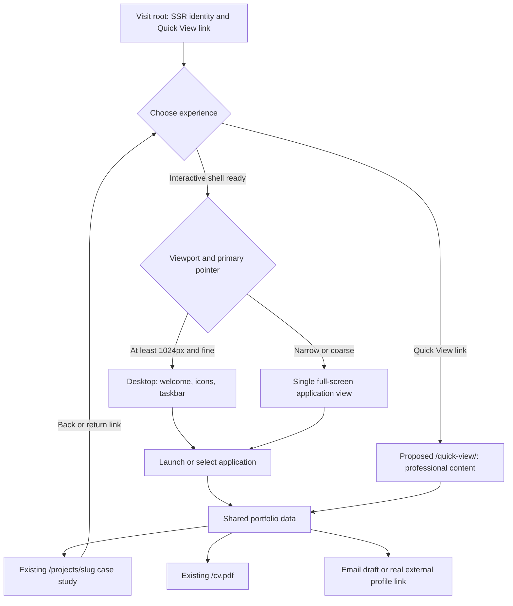
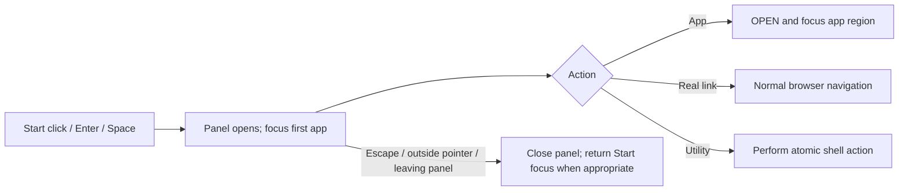
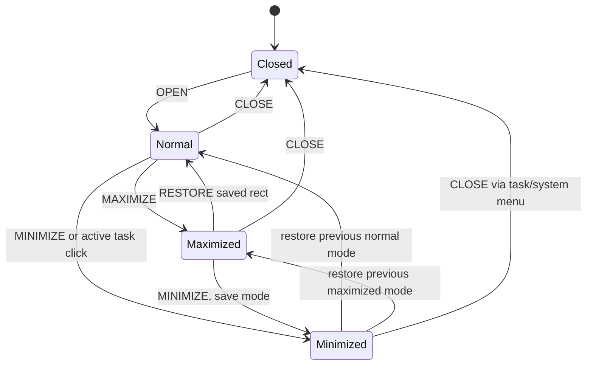

# AXL_OS XP — Application and interaction flows

Draft 1; recommendations, not tested behavior. Approval PENDING. Source features
and risks are in [PRD](01-PRD.md); state types in [TRD](02-TRD.md), task IDs in
[implementation plan](05-IMPLEMENTATION-PLAN.md). All routes marked proposed
must be implemented later; existing `/projects/<slug>` and `/cv.pdf` remain.

## Visitor journeys

Desktop defaults: welcome profile opens centered, selected shortcut matches it.
Primary screen presents identity and one visible Quick View link before any
interaction. Optional boot cannot hide identity/Quick View or delay their use.
Quick View shows all professional sections in one document with visible in-page
navigation and an “Open interactive desktop” link. It never runs boot/video or
hydrates the window manager. Professional destinations require at most two
actions from the desktop and one direct Quick View section link.

## Shortcut and application navigation

| Input | Desktop fine pointer | Tablet/mobile/coarse pointer |
| --- | --- | --- |
| Single click/tap shortcut | Select with focus ring and readable label; offer adjacent/contextual Open action | Single tap OPEN; selected app occupies usable screen |
| Double click | OPEN exactly once, no minimize | Not required; second tap merely reactivates |
| Enter on shortcut | OPEN selected app | Native button activation OPEN |
| Space on shortcut | Select without launch, prevent page scroll | Native activation or clearly labeled Open button; no double-tap gate |
| Arrows on icon area | Roving focus with known grid order; Home/End first/last | Standard list navigation/Tab; no simulated desktop drag |
| Tab | Enter icon grid at selected/first shortcut, then Open action, active app, taskbar/Quick View in logical order | App header/back, body actions, navigation; no blocked body |
| Background click | Clear icon selection; close transient menu, no unintended app close | Dismiss navigation overlay if outside, retain app |

Default desktop grid has profile, skills, projects, experience, certificates,
contact, resume link; Extras and utilities in second column or Start submenu.
Resume is a link, not an artificial window instance. Each registry ID is singleton.
No browser-native right-click override on document; text selection/copy works.

Application mappings:

| Application | Shared content/navigation |
| --- | --- |
| Welcome Center (`hero`) | Profile, CV, Explore Projects OPEN action, Contact OPEN action, Quick View link |
| My Computer (`skills`) | Categories + skill selection/details, no fake storage or CPU telemetry |
| My Projects (`projects`) | All eight summaries, category filter, preview, existing case-study/source URLs; reset filters available |
| Work History (`experience`) | Four current records, readable timeline/list |
| My Certificates (`certificates`) | Six entries, selected preview/zoom/raw file; normal app plus one true modal on demand |
| Contact (`contact`) | Draft form, clear, direct email/LinkedIn/GitHub, honest mail-client notice |
| Extras (`browser`, `p5r`, `apex`, `elden`) | Preserved local demos, directory links; themed app bodies within common Luna chrome |

Explorer: selection changes preview without navigation; Enter on row opens
preview and focuses its heading; explicit “Read case study” navigates browser.
Search/category inputs update list, announce result count politely, preserve
selected item only if still present otherwise select first result/empty state.
The taskbar always represents Projects once, regardless of selected project.

## Start menu flow

Start is a disclosure panel with native navigation links/buttons, not an ARIA
menu unless the full menu pattern is implemented. aria-expanded + aria-controls
reference stable panel ID. Two columns: left apps/Extras; right Quick View,
projects/history/certificates, CV and contact links. Header shows identity.
Footer contains “Replay intro” and “Close all apps”, with utility labels; no
pretend logout/shutdown backend. Do not intercept OS Windows key or Alt+Tab.

Arrow navigation may supplement Tab through native items; Home/End scoped to
panel. Tab never trapped. Escape closes panel only; outside pointer preserves
the clicked target's focus rather than stealing it back to Start. App selection
closes menu then focuses app. A click on Start while open closes it without
reopening through the outside-event handler.

## Window lifecycle

FOCUS/OPEN on visible app preserves mode/position; only task activation may
minimize the already active app. Window controls cannot start title drag. Title
double-click toggles maximize/restore only on desktop. Maximize fills workspace
above taskbar; restore returns the saved clamped rect. Close removes task and
resets ephemeral content, consistent with current unmount semantics. Minimize
preserves form/filter/extra state by hiding visited renderer, with no hidden
keyboard focus. Closed/unvisited apps do not load heavy extra code.

Focus/stack: interacting with app content raises it; keyboard focus into its
region raises it. Only one visible active app, active ID is stack front. Losing
an app to close/minimize selects previous front, then remembered connected
descendant or heading; if none, focus invoking shortcut/Start fallback. No focus
ring behind a higher window. Nonmodal app bodies do not trap Tab.

Taskbar: visible inactive -> focus; active visible -> minimize; minimized ->
restore previous mode; closed -> absent. Long lists overflow within task strip
with reachable keyboard controls; Start, Show Desktop and tray cannot be pushed
offscreen. Show Desktop saves visible set, minimizes it, then restores only
still-open saved apps; opening/closing explicitly clears its snapshot.

Open portfolio apps preserves the old launch-all utility for five core apps,
plus certificates as part of the approved redesign; explicitly raise Welcome
last so active identity matches stack. Keep this utility separate from Quick
View. Minimize All/Close All affect only open apps. Replay intro is cosmetic,
does not clear state, navigate or synthesize sound without opt-in.

## Gesture and keyboard movement

Desktop title drag uses pointer capture; movement bounded to usable rectangle.
Resize edges/corner use the same bounds and minimum capped by viewport. RAF/local
transient updates; commit rect on release. Pointercancel/lost capture/route
unmount stops every listener/RAF; Escape restores gesture-start geometry.
Viewport changes cancel current gesture then clamp before drawing next frame.

System icon/menu is a button: Move, Resize, Center, Fit, Minimize,
Maximize/Restore, Close. Move arrows 10px, Shift+arrow 1px; Resize arrows adjust
width/height with same steps; Enter commits, Escape cancels. Center/Fit buttons
provide single-click/tap alternatives to dragging. Disabled operations have
disabled semantics and do not pretend to work in full-screen app-view.

Escape priority: top certificate modal -> active system menu/gesture -> Start
panel -> current transient selection UI. Escape in ordinary form editing does
not close the app or discard text. No global destructive close shortcut. Provide
an explicitly labeled keyboard app-switcher/button; do not hijack OS shortcuts.
All app controls have names including the app title. Live clock is not aria-live.

## Adaptive navigation and breakpoints

- <768px: mobile full-screen app view. Home/application list shows identity and
  large native launch controls. Sticky header includes Back to apps, title and
  Quick View. Body scrolls; bottom application switcher uses safe-area padding.
  Open another app preserves previous visited state; close goes to previous open
  app or app list. Browser Back follows explicit URL intent.
- 768–1023px: tablet full-screen app view, optional two-column application body
  when its own content width permits. Landscape remains app-view; no forced drag.
- >=1024px + primary fine pointer: bounded desktop. Coarse primary input remains
  app-view even at wide width; do not restrict secondary mouse/keyboard access.
- Browser zoom/effective viewport can switch layout. Preserve open/minimized
  registry states and selections; no resize auto-open. Single selected visible
  app in app-view is stack front; others are switchable, not destroyed.
- On return to desktop, restore last desktop rectangles then clamp. There is
  no separate mobile dataset and no floating certificate badge outside navigation.

## Quick View and fallback flows

Proposed `/quick-view/`: SSR heading/profile, core skill groups, featured projects
(first three by explicit curated ordering) plus all-project links, experience,
certificate links, CV/contact, Extras directory. Data come from the same modules
and CC adapter as the desktop. No copy of project summaries in route code.
Print-friendly stylesheet hides shell decoration and keeps links/labels legible.

Root refresh parses approved hash; valid app opens normal default geometry and
selected project, invalid app/slug shows welcome + recoverable notice. Existing
project routes render on refresh regardless of desktop JS. Root no-JS: identity
and Quick View anchor visible; avoid opacity-0 dependency; Quick View all content
and basic links work with JS disabled. Do not claim interactive OS works no-JS.

| State | Required result |
| --- | --- |
| Empty project filter | Clear message + reset action; no bogus default project |
| Missing optional cover/gallery | Stable placeholder with descriptive text; no broken image or invented screenshot |
| Failed lazy app module | Named retry + Quick View fallback; fail only that app, not entire desktop |
| Mail client unavailable | Explain that mailto opens the local client; visible address/copy/manual option; no “message sent” claim |
| PDF unsupported | Real `/cv.pdf` open/download link; no dependency on iframe viewer |
| Unknown project route | Existing 404 redesigned consistently; root/Quick View return links |
| Touch rotation/browser chrome | Recalculate usable `100dvh` bounds/safe area; actions remain visible |
| Modal close/Escape | Return focus to still-connected originating certificate button or app heading |
| Reduced motion | Immediate state changes/static wallpaper; no boot flash, zoom or forced smooth scroll |

No browser evidence was produced for these proposed flows; execute T01 baseline
and T24 regression suite after approval, then Codex reviews independently.
